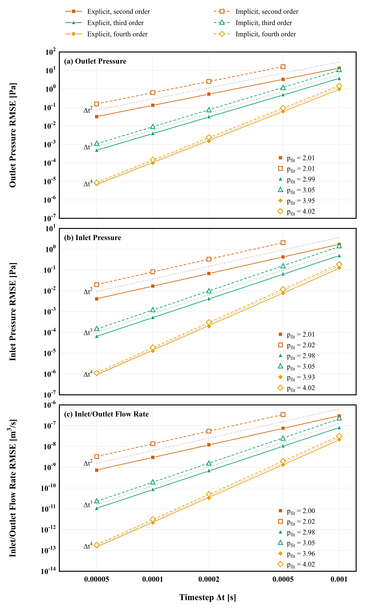

# Time Convergence of the Closed-Loop Pipe: `pipeClosedLoop`

Prepared by David Kelly

---

## Tutorial Aims

- Measure the temporal order of accuracy of the CFD-circuit coupling for a pipe
  in a closed circulation loop, for explicit and implicit coupling of order 2, 3
  and 4.
- Provide, for every scheme, order and time step, a ready-to-run case and the
  scripts that analyse and plot the order of accuracy.

---

## Case Overview

A 3D pipe (4 cm x 30 cm, 24,675 cells) whose two ends are coupled to a closed
lumped circulation (`constant/circulationProperties`): the outlet is attached
to the first arterial compliance, the inlet to the last, and the heart closes
the loop. The cases run for three cardiac cycles (`endTime 2.4`) and are laid
out by coupling scheme, order and time step:

```text
explicit/ implicit/
    secondOrder/ thirdOrder/ fourthOrder/
        prelude  dt_1e-3  dt_5e-4  dt_2e-4  dt_1e-4  dt_5e-5  dt_1e-5
```

The exception is `implicit/secondOrder`, which has no `dt_1e-3`: implicit
second-order coupling does not converge at that time step. `dt_1e-5` is the
reference level: the error of every other level is its difference from the
`dt_1e-5` run of the same scheme and order.

The coupling order of each case is `order` in `constant/circulationProperties`,
and the CFD time scheme is the `BDF` scheme of the same order, `BDF 2`, `BDF 3`
or `BDF 4` (in `system/fvSchemes`; not the built-in `backward`). The circuit is
integrated with `RKDP45` in every case, with `absTol 1e-20` and `relTol 1e-13`.

The cases of a scheme and order differ **only** in `deltaT` and `writeInterval`
(`system/controlDict`, one output per cardiac cycle); the schemes and orders
differ in `scheme` and `order` (`constant/circulationProperties`) and the
`ddtSchemes` entry of `system/fvSchemes`. Everything else is identical: the
mesh, `fvSolution` (solver tolerances `1e-8`, `nOuterCorrectors 120`), the
boundary conditions, the circuit and its initial state, and the function
objects, which write the pressure and flow of both patches at every step at
full precision.

### Seeded start

A run started from rest at `t = 0` takes its first steps with fewer older
time levels than the scheme needs (Euler, `BDF 2`, ... for the CFD; fewer past
flows for the circuit), and the start-up error of those steps limits the
observed order of the higher-order schemes. The cases are therefore started at
`t = 4e-3` with full history, as follows:

1. `prelude` runs from rest at `t = 0` to `t = 4e-3` with `dt = 1e-6`. It
   writes the fields every 1e-5 and, in `postProcessing`, the inlet and outlet
   flow of every step.
2. The `runCase` of each `dt_*` calls `seedCase`, which builds the start of
   that case in its own directory from the prelude: the fields `U`, `p` and
   `phi` at `t = 4e-3`; the three older time levels `U_0`, `U_0_0`, `U_0_0_0`
   and `phi_0`, `phi_0_0`, `phi_0_0_0` from the prelude at
   `4e-3 - k dt`, `k = 1` to 3; and the circuit state with its flow history
   spaced `dt` apart, in `circulationState-circulationProperties`.
3. The case then runs from `t = 4e-3` to 2.4 at its own `dt`.

Every case, whatever its `dt`, therefore starts from the same state, and the
`BDF` scheme and the coupling run at their full order from the first step.
Each `prelude/runCase` also deletes the prelude times that no `dt_*` needs.

| File | Purpose |
| --- | --- |
| `<scheme>/<order>/prelude/runCase` | the `dt = 1e-6` run from rest to 4e-3 |
| `<case>/runCase` | `seedCase`, then pimpleFoam on 8 ranks |
| `seedCase` | the seeded start of one case, from its prelude |
| `<case>/Allclean`, `Allclean` | clean one case, or all of them and the plots |
| `plots/analyse_order.py` | RMSE against `dt_1e-5` and the orders |
| `plots/plotOrderOfAccuracy.py` | the order-of-accuracy figure |
| `plots/figure_style.py` | fonts and line widths of the figure |

---

## Running the Case

The cases need OpenFOAM.com and the `circulationModels` module and `BDF` ddt
scheme to be built: `libs` in `system/controlDict` loads
`libcirculationCoupling` and `libsolids4FoamModels` (which holds the `BDF`
scheme). They are decomposed for 8 ranks and need `mpirun`.

Run the six preludes first, then the cases of a scheme and order:

```bash
(cd explicit/secondOrder/prelude && ./runCase)    # ./Allclean to clean
cd explicit/secondOrder/dt_1e-3
./runCase                       # log.seedCase, log.pimpleFoam
```

and, once every case has run, from this directory:

```bash
python3 plots/plotOrderOfAccuracy.py    # needs rsvg-convert for the PNG
```

The script is `runCase`, not `Allrun`, so that `tutorials/Alltest` does not run
these long cases. Each case uses 8 ranks, so run them one at a time. On a
14-core Apple laptop (8 ranks) a case takes, in wall-clock time:

| dt | explicit | implicit |
| --- | --- | --- |
| 1e-3 | about 1 min | 3 to 6 min |
| 2e-4 | 4 to 5 min | 5 to 8 min |
| 5e-5 | 16 to 18 min | 17 to 27 min |
| 1e-5 | about 1 h | about 1 to 2 h |

The whole set of 35 cases and six preludes takes about 12 hours, and about
6 GB: the processor directories of the finest cases, `log.pimpleFoam` and the
per-step records. The finest levels are the natural ones to run on a cluster;
each case is independent once its prelude has run.

---

## Expected Results

`plots/analyse_order.py` computes, for three quantities, the outlet pressure,
the inlet pressure and the inlet/outlet flow rate, the RMSE of every run
against the `dt_1e-5` run of the same scheme and order. The RMSE is taken over
the output times common to all runs in `1.6 <= t <= 2.4`, the last cardiac
cycle, and the fitted order `p_fit` is the least-squares slope of `ln RMSE`
against `ln dt` over the levels shown. It writes `plots/orderAccuracy.json`
and `orderAccuracy.csv`. `plots/plotOrderOfAccuracy.py` draws the three
quantities as stacked panels (`plots/orderOfAccuracy.png`).



Fitted order `p_fit` over all time steps shown (theory 2, 3, 4):

| Quantity | Coupling | 2nd | 3rd | 4th |
| --- | --- | ---: | ---: | ---: |
| Outlet pressure | Explicit | 2.011 | 2.986 | 3.955 |
| Outlet pressure | Implicit | 2.013 | 3.051 | 4.016 |
| Inlet pressure | Explicit | 2.011 | 2.983 | 3.932 |
| Inlet pressure | Implicit | 2.018 | 3.048 | 4.016 |
| Inlet/outlet flow | Explicit | 2.001 | 2.983 | 3.958 |
| Inlet/outlet flow | Implicit | 2.016 | 3.048 | 4.020 |

Known limits:

- Explicit order 1 is unstable at `dt_1e-3`, and is not included.
- Implicit second order does not converge at `dt_1e-3`, and starts at
  `dt_5e-4`.
- BDF 3 and 4 are not A-stable: a warning is printed, and a large step can
  amplify the pipe-compliance oscillation (about 30 Hz).
- Implicit coupling needs many outer correctors at the larger steps
  (`nOuterCorrectors 120`).

---

## Verification and Convergence Study

Checked: the orders reach the theoretical values. Each scheme converges at its
coupling order, and the `BDF` scheme of the same order does not limit it. The
seeded start matters: every case runs at full order from its first step (no
"only n earlier flows" warning in any `log.pimpleFoam`).

Checked: the order between the two finest levels of the explicit fourth-order
scheme, 3.67 for the outlet pressure, is below 4, which lowers its `p_fit` to
3.93 to 3.96. The cause has not been established.
