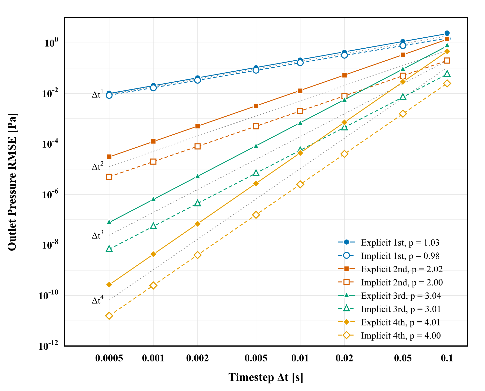
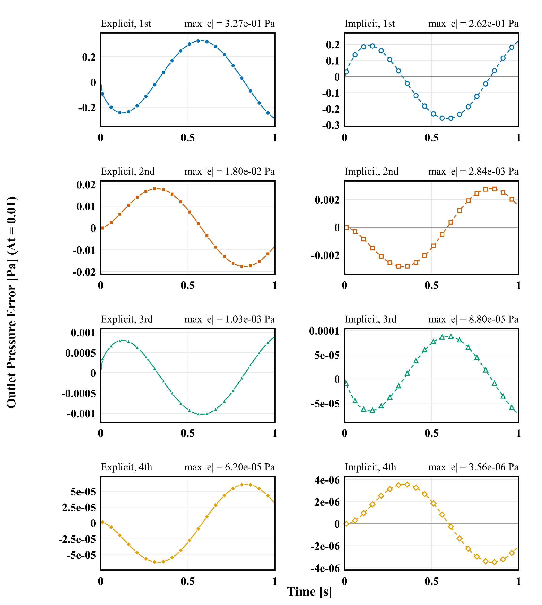

# Time Convergence of the Pipe-Windkessel: `pipeWindkessel`

Prepared by David Kelly

---

## Tutorial Aims

- Measure the temporal order of accuracy of the CFD-circuit coupling against an
  exact solution, for explicit and implicit coupling of order 1 to 4.
- Provide, for every scheme, order and time step, a ready-to-run case and the
  scripts that analyse and plot the order of accuracy.

---

## Case Overview

A pipe whose outlet is coupled to a three-element Windkessel: the inlet
prescribes `Q(t) = sin(2 pi t)`, the outlet pressure comes from the circuit,
and the outlet pressure `Po(t)` has a closed form (`analyse.py`). The cases run
to `t = 1`, one forcing period, and are laid out by coupling scheme, order and
time step:

```text
explicit/ implicit/
    firstOrder/ secondOrder/ thirdOrder/ fourthOrder/
        dt_0.1  dt_0.05  dt_0.02  dt_0.01  dt_0.005  dt_0.002  dt_0.001  dt_0.0005
```

The coupling order of each case is `order` in `constant/circulationProperties`,
and the CFD time scheme is the `BDF` scheme of the same order, `BDF 1` to
`BDF 4` (in `system/fvSchemes`; not the built-in `backward`). The circuit is
integrated with `RKDP45` in every case, with `absTol 1e-14` and `relTol 1e-12`.
The tolerances apply to the compliance volume `V = C Pc` with `C = 0.01`, so
`absTol 1e-14` is 1e-12 Pa.

The cases differ **only** in `scheme`, `order`, `seed` and `seedDeltaT` (in
`constant/circulationProperties`), the `ddtSchemes` entry of `system/fvSchemes`,
and `deltaT` in `system/controlDict`. Everything else is identical: the mesh,
`fvSolution`, the boundary conditions and the function object, which writes the
outlet pressure at every step at full precision. `seed` is the exact outlet
flow `Q(-k dt) = -sin(2 pi k dt)` for `k = 1` to 3, so that every scheme starts
at full order; each reads only as many as it needs.

| File | Purpose |
| --- | --- |
| `<case>/runCase` | blockMesh, then pimpleFoam (serial) |
| `<case>/Allclean`, `Allclean` | clean one case, or all of them and the plots |
| `analyse.py` | RMSE against the exact solution, and the orders |
| `plots/analyse_order.py` | the orders of all cases, to `orderAccuracy.json` |
| `plots/plotOrderOfAccuracy.py` | the order-of-accuracy figures |
| `plots/plotTimeSeries.py` | `Po(t)` and its error against the exact solution |
| `plots/figure_style.py` | fonts and line widths of the figures |

---

## Running the Case

The cases need OpenFOAM.com and the `circulationModels` module and `BDF` ddt
scheme to be built: `libs` in `system/controlDict` loads
`libcirculationCoupling` and `libsolids4FoamModels` (which holds the `BDF`
scheme).

```bash
cd implicit/fourthOrder/dt_0.05
./runCase                       # log.pimpleFoam; ./Allclean to clean
cd ../../.. && python3 analyse.py
```

To run all 64 cases, a few at a time (each is serial):

```bash
ls -d */*/dt_* | xargs -P 8 -I{} ./{}/runCase
python3 plots/plotOrderOfAccuracy.py    # needs every case; rsvg-convert for PNG
python3 plots/plotTimeSeries.py         # dt = 0.1, 0.01, 0.001; or name the dts
```

The finest cases take the longest: about 7 CPU-hours in total, and about 35
minutes with 12 cases in parallel. The results take about 670 MB. The script
is `runCase`, not `Allrun`, so that `tutorials/Alltest` does not run all 64
cases.

---

## Expected Results

`analyse.py` prints, for every case that has run, the RMSE of `Po` over
`0 < t <= 1` against the exact solution, the order between neighbouring time
steps, and the fitted order. `plots/plotOrderOfAccuracy.py` draws all eight
series (`plots/orderOfAccuracy.png`, and `orderOfAccuracyNoGuides.png` without
the reference slopes):



`plots/plotTimeSeries.py` draws, for each of `dt = 0.1`, `0.01` and `0.001`
(or the time steps given on its command line), the outlet pressure of the eight
algorithms on one axis against the exact solution
(`plots/outletPressure_dt<dt>.png`), and the pointwise error `Po - Po_exact`
with one panel per algorithm (`plots/pointwiseError_dt<dt>.png`). Each error
panel has its own vertical scale, since the errors of the first and fourth
order differ by many orders of magnitude; the largest error is printed on it.



RMSE of `Po` (Pa), explicit coupling:

| dt | 1st | 2nd | 3rd | 4th |
| --- | ---: | ---: | ---: | ---: |
| 0.1 | 2.460e+00 | 1.437e+00 | 8.026e-01 | 4.659e-01 |
| 0.05 | 1.128e+00 | 3.385e-01 | 9.116e-02 | 2.855e-02 |
| 0.02 | 4.260e-01 | 5.180e-02 | 5.432e-03 | 7.101e-04 |
| 0.01 | 2.088e-01 | 1.274e-02 | 6.620e-04 | 4.376e-05 |
| 0.005 | 1.034e-01 | 3.157e-03 | 8.168e-05 | 2.713e-06 |
| 0.002 | 4.109e-02 | 5.025e-04 | 5.187e-06 | 6.909e-08 |
| 0.001 | 2.050e-02 | 1.254e-04 | 6.466e-07 | 4.310e-09 |
| 0.0005 | 1.024e-02 | 3.133e-05 | 8.072e-08 | 2.691e-10 |

RMSE of `Po` (Pa), implicit coupling:

| dt | 1st | 2nd | 3rd | 4th |
| --- | ---: | ---: | ---: | ---: |
| 0.1 | 1.470e+00 | 1.994e-01 | 5.856e-02 | 2.481e-02 |
| 0.05 | 7.827e-01 | 5.008e-02 | 7.133e-03 | 1.575e-03 |
| 0.02 | 3.250e-01 | 8.006e-03 | 4.463e-04 | 4.022e-05 |
| 0.01 | 1.646e-01 | 2.000e-03 | 5.532e-05 | 2.507e-06 |
| 0.005 | 8.280e-02 | 4.997e-04 | 6.884e-06 | 1.564e-07 |
| 0.002 | 3.324e-02 | 7.992e-05 | 4.394e-07 | 3.998e-09 |
| 0.001 | 1.664e-02 | 1.998e-05 | 5.487e-08 | 2.498e-10 |
| 0.0005 | 8.327e-03 | 4.994e-06 | 6.857e-09 | 1.578e-11 |

Fitted order over all eight time steps (theory 1, 2, 3, 4):

| Coupling | 1st | 2nd | 3rd | 4th |
| --- | ---: | ---: | ---: | ---: |
| Explicit | 1.029 | 2.023 | 3.036 | 4.015 |
| Implicit | 0.980 | 2.000 | 3.011 | 3.999 |

The orders between neighbouring time steps approach the theoretical values as
`dt` falls; the offsets from the integers at the coarse end are the next term of
`e = C dt^p (1 + a dt + ...)`. The implicit fourth-order error at the finest
time step is 1.6e-11 Pa, close to the tolerances of the circuit solve
(1e-12 Pa) and of the flow solver, so the order between the two finest levels,
3.985, is slightly below 4.

---

## Verification and Convergence Study

Checked: apart from the entries listed above, every file is identical in all
64 cases.

Checked: the CFD time scheme does not change `Po` in this case. The inlet flow
is prescribed and the flow is incompressible, so the outlet flow equals the
inlet flow whatever the CFD scheme does inside the pipe, and `Po` is set by
the coupling alone. For implicit second-order coupling, `BDF 2` and `BDF 4`
give the same `Po` to about 1e-16 (kinematic) at `dt = 0.01` and `0.002`. The
`BDF` order is matched to the coupling order here for consistency. To see the
CFD time scheme limit the order, use the closed-loop pipe, `pipeClosedLoop`.

Checked: the ODE solver, with the tolerances above, does not change the order.
`Trapezoid` at the same tolerances gives the same `Po` as `RKDP45` to 1.6e-12 Pa
for explicit second order at `dt = 0.005`. For implicit fourth order at
`dt = 0.002` to `0.0005` it keeps the order, about 4, but differs from `RKDP45`
by about 7e-12 Pa at every `dt`, which is visible only where the error itself
is that small (the finest implicit fourth-order level). `RKDP45` is used for
every case.
